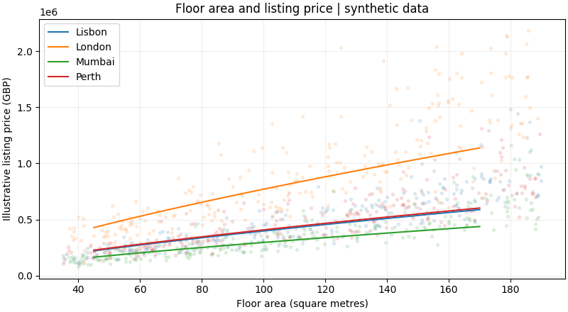

# Global House Price Analysis

How does floor area relate to listing price after accounting for bedrooms, bathrooms and city? This runnable portfolio case study adapts collaborative ST236 Python for Data Analytics coursework at the University of Warwick, which analysed listings from Lisbon, London, Mumbai and Perth. The public notebook uses synthetic listings and illustrative currency conversion factors.



## Workflow and results

- Combine four tables, standardise prices to GBP and floor area to square metres, and remove duplicate or incomplete rows. This leaves 956 of 964 synthetic rows.
- Fit a log-linear regression with city, floor area, bedrooms and bathrooms. Compare it with a city-only baseline on a 25% holdout stratified by city.
- On this synthetic holdout, log-price RMSE fell from **0.539 to 0.236**. The fitted floor-area elasticity was **0.734**, so a 1% increase in area corresponds to roughly 0.73% higher fitted price when the other inputs are held fixed. The model uses a common elasticity across cities.

The figures illustrate the workflow. Real market comparisons would require verified listing data, exchange rates tied to listing dates, and an evaluation designed around the intended use, such as a later time period for forecasting.

## Run locally

```bash
python -m pip install -r requirements.txt
jupyter lab analysis.ipynb
```

Run all notebook cells to reproduce the metrics and chart. The notebook generates its own data.
